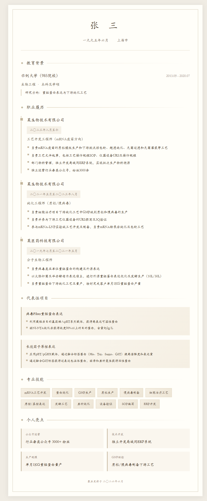
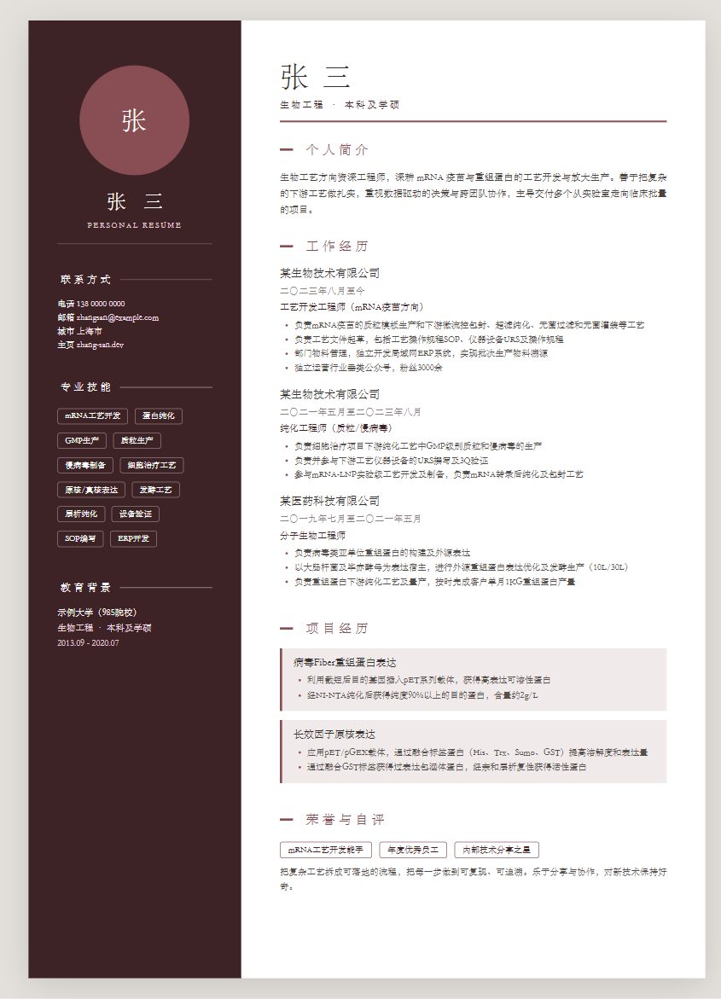
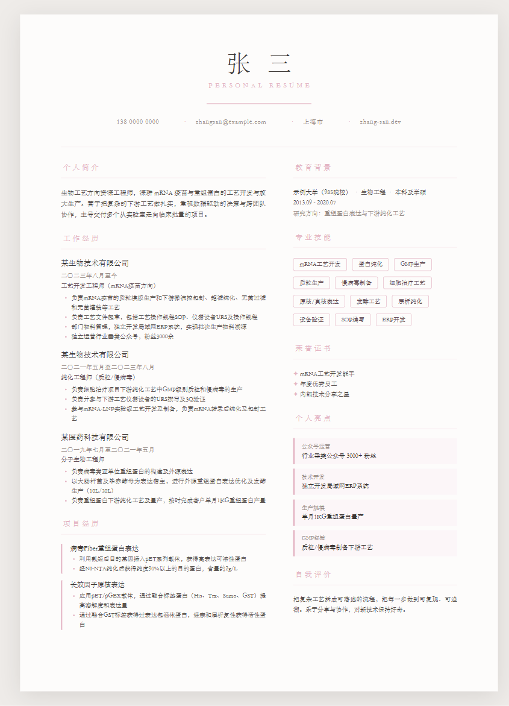
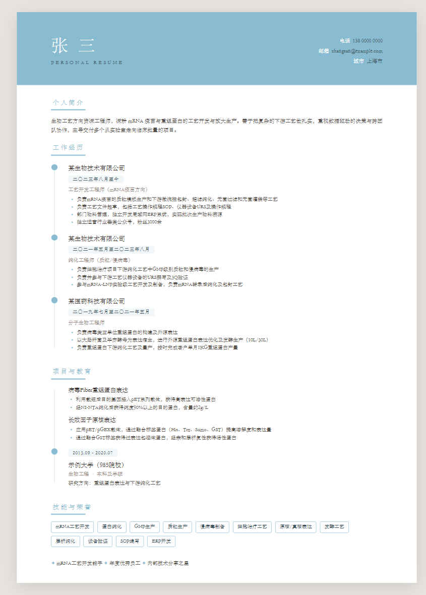
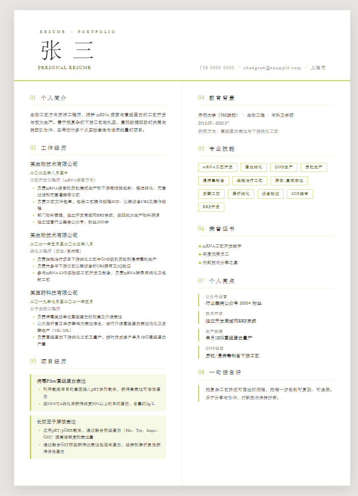
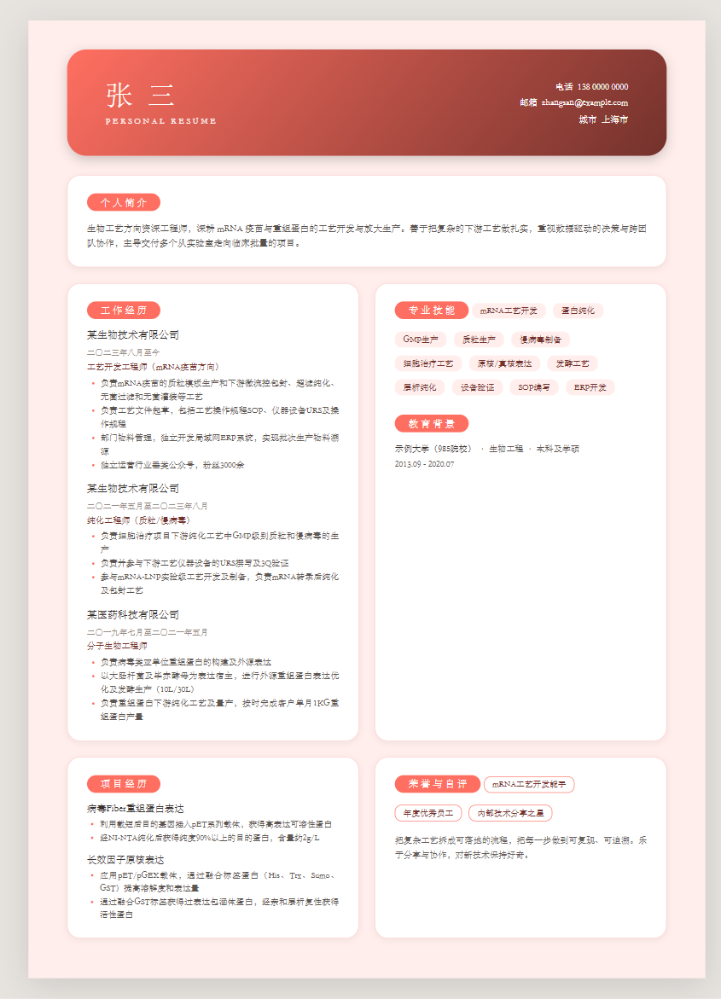
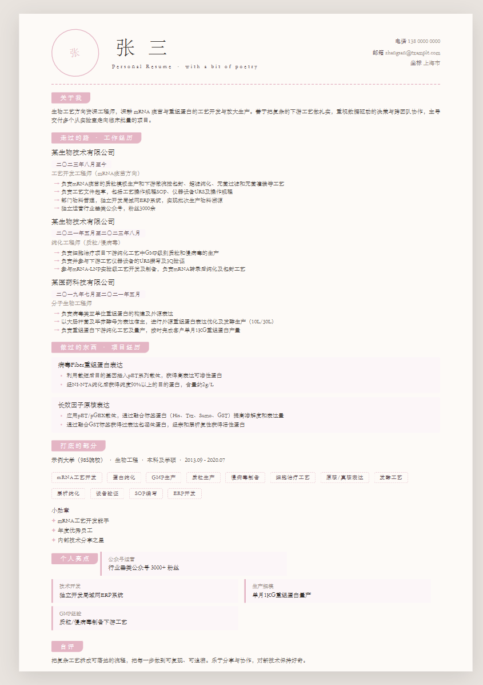
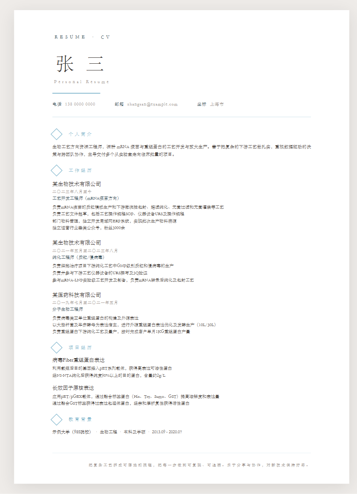

# Personal Resume — 多模板简历生成器

<p align="center">
  
  
  
</p>

> 一个基于 **Markdown / Word 简历文档**的个人简历生成器 Skill。输入 `.md` 或 `.docx` 简历文档，一键生成可预览、截图或打印为 PDF 的 A4 HTML 简历。支持「楷体雅致」与「霞鹜致宋」两套视觉系统、8 套模板与 12 种配色，并会自动检查分节完整性、引导补齐或跳过。

## 功能特性

- 🎨 **两套视觉系统**：楷体雅致（暖棕、菱形标记）；霞鹜致宋（7 套版式：左右分栏 / 极简 / 时间线 / 杂志 / 卡片 / 手账 / 留白）
- 🎨 **12 种配色**：红棕 / 烟粉 / 柳黄 / 浅驼色 / 云峰白 / 秋波蓝 / 橄榄黄绿 / 珍珠灰 / 杏仁黄 / 奶油白 / 菠萝红 / 海棠
- 📄 **文档驱动**：基于 Markdown（.md）与 Word（.docx）简历文档生成，按分节自动识别（兼容结构化 JSON）
- 📄 **A4 标准尺寸**：210mm × 297mm，浏览器直接打开即成品
- 🔒 **本地处理**：全部在本地完成，不上传任何数据，保护隐私
- 🖨️ **多种输出**：浏览器预览 / Ctrl+P 存 PDF / 开发者工具截全页
- 💬 **内容引导**：自动检查分节完整性，缺失的必备分节引导补齐，可选分节（荣誉/亮点/自评）可选择跳过

## 模板与配色预览

**交互式预览页**：打开 [`preview/index.html`](preview/index.html)，可在 8 套模板 × 12 种配色间实时切换预览（示例数据：张三 · 生物工艺方向）。

| 模板 | 预览 |
|------|------|
| 楷体雅致 |  |
| 致宋 · 经典左右分栏 |  |
| 致宋 · 极简居中 |  |
| 致宋 · 叙事时间线 |  |
| 致宋 · 杂志版面 |  |
| 致宋 · 圆角卡片 |  |
| 致宋 · 文创手账 |  |
| 致宋 · 留白大气 |  |

## 快速开始

```bash
# 1. 准备 Markdown / Word 简历（格式见下方「Markdown 简历格式」）
# 2. 使用示例数据测试（默认楷体雅致）
python scripts/generate.py examples/resume.md

# 3. 致宋 · 经典左右分栏 + 烟粉配色
python scripts/generate.py examples/resume.md --template zhisong-sidebar --color smoke-pink

# 4. 从 Word 简历生成（自动识别 .docx）
python scripts/generate.py resume.docx --template zhisong-breath

# 5. 致宋 · 圆角卡片 + 秋波蓝，指定输出路径
python scripts/generate.py resume.md --template zhisong-cards --color 秋波蓝 --output my_resume.html

# 6. 使用自定义模板
python scripts/generate.py resume.md --template templates/kaiti-elegant.html

# 7. 查看分节完整性报告（引导补齐/跳过）
python scripts/generate.py resume.md --check
```

生成成功后用浏览器打开 HTML 即可预览，Ctrl+P 可另存为 PDF。

## 模板一览

| 模板名 | 风格 | 配色支持 |
|--------|------|---------|
| `kaiti-elegant` | 楷体雅致（默认） | — |
| `zhisong-sidebar` | 致宋 · 经典左右分栏 | ✅ 12 色 |
| `zhisong-minimal` | 致宋 · 极简居中 | ✅ 12 色 |
| `zhisong-timeline` | 致宋 · 叙事时间线 | ✅ 12 色 |
| `zhisong-magazine` | 致宋 · 杂志版面 | ✅ 12 色 |
| `zhisong-cards` | 致宋 · 圆角卡片 | ✅ 12 色 |
| `zhisong-handbook` | 致宋 · 文创手账 | ✅ 12 色 |
| `zhisong-breath` | 致宋 · 留白大气 | ✅ 12 色 |

## Markdown 简历格式（推荐）

输入按标题分节，列表项作条目，`·` 分隔公司/职位/时间。支持的分节标题：个人简介 / 教育背景 / 工作经历 / 项目经历 / 专业技能 / 荣誉证书 / 个人亮点 / 自我评价。

```markdown
# 张三

电话：138 0000 0000
邮箱：zhangsan@example.com
城市：上海市

## 个人简介
生物工艺方向资深工程师，深耕 mRNA 疫苗工艺开发。

## 教育背景
示例大学（985院校） · 2013.09 - 2020.07 · 生物工程 · 本科及学硕

## 工作经历
### 某生物技术有限公司 · 工艺开发工程师（mRNA疫苗方向） · 2023.08至今
- 负责mRNA疫苗的质粒模板生产和下游纯化工艺
- 负责工艺文件起草，包括工艺操作规程SOP

### 某医药科技有限公司 · 分子生物工程师 · 2019.07-2021.05
- 负责病毒类亚单位重组蛋白的构建及外源表达

## 项目经历
### 病毒Fiber重组蛋白表达
- 利用截短后目的基因插入pET系列载体
- 经NI-NTA纯化后获得纯度90%以上的目的蛋白

## 专业技能
- mRNA工艺开发
- 蛋白纯化

## 荣誉证书
- mRNA工艺开发能手

## 个人亮点
- 公众号运营：行业垂类公众号 3000+ 粉丝

## 自我评价
把复杂工艺拆成可落地的流程。
```

> **Word（.docx）**：直接读取正文段落，按标题/分节同样规则识别；**结构化 JSON（.json）** 亦兼容，字段与上述分节一致。完整字段说明见 [SKILL.md](SKILL.md)。

## 内容引导

用户提交的简历若未按标准分节书写，skill 会先检查分节完整性并引导补齐：
- **必备分节**：个人简介 / 教育背景 / 工作经历 / 专业技能 / 联系方式 / 项目经历（缺失时引导补充）
- **可选分节**：荣誉证书 / 个人亮点 / 自我评价（可跳过）

```bash
# 先查看分节检查报告
python scripts/generate.py resume.md --check
```

用户可随时说"跳过"，对应分节不展示。详细引导规则见 [SKILL.md](SKILL.md)。

## 字体说明

- **楷体雅致**：使用系统楷体（STKaiti / KaiTi），无需额外文件；
- **霞鹜致宋**：使用霞鹜致宋字体 `LXGWZhiSongMN.ttf`（约 8.7MB），已随仓库分发于 `assets/fonts/` 目录，clone 后开箱即用；生成时脚本自动复制到输出目录。缺失（或使用不带字体的旧副本）时回退系统宋体，仍可正常使用。

## 目录结构

```
personal-resume/
├── SKILL.md                    # Skill 定义文件（含触发条件与使用说明）
├── README.md                   # 本文件
├── preview/                    # 交互式模板预览（index.html + 示例 + 缩略图）
├── reference/
│   ├── kaiti-style.md          # 楷体雅致视觉规范
│   └── zhisong-style.md        # 霞鹜致宋视觉规范
├── templates/
│   ├── kaiti-elegant.html      # 楷体雅致模板（默认）
│   ├── zhisong-sidebar.html    # 致宋 · 经典左右分栏
│   ├── zhisong-minimal.html    # 致宋 · 极简居中
│   ├── zhisong-timeline.html   # 致宋 · 叙事时间线
│   ├── zhisong-magazine.html   # 致宋 · 杂志版面
│   ├── zhisong-cards.html      # 致宋 · 圆角卡片
│   ├── zhisong-handbook.html   # 致宋 · 文创手账
│   └── zhisong-breath.html     # 致宋 · 留白大气
├── scripts/
│   └── generate.py             # 生成脚本（Markdown / Word → HTML，兼容 JSON）
└── examples/
    ├── resume.md               # 示例数据 · Markdown 格式（推荐）
    └── wushengjun.json         # 示例数据 · JSON 格式（兼容）
```

## 触发关键词

个人简历、生成简历、简历模板、楷体、楷体雅致、kaiti、致宋、霞鹜、zhisong、personal resume、从 Markdown 生成简历、从 Word 生成简历

## 使用场景

1. **从 Markdown / Word 文档生成**：上传或指定 `.md` / `.docx` 简历文档，自动识别分节并生成
2. **口述内容生成**：口述个人信息，助手整理后生成
3. **更新现有简历**：修改文档或更换配色，重新生成 HTML

## 许可

本项目作为 Skill 开源发布，仅含通用模板与示例（示例数据为脱敏占位内容）。霞鹜致宋字体遵循 [IPA Font License 1.0](https://opensource.org/licenses/IPA/)。
